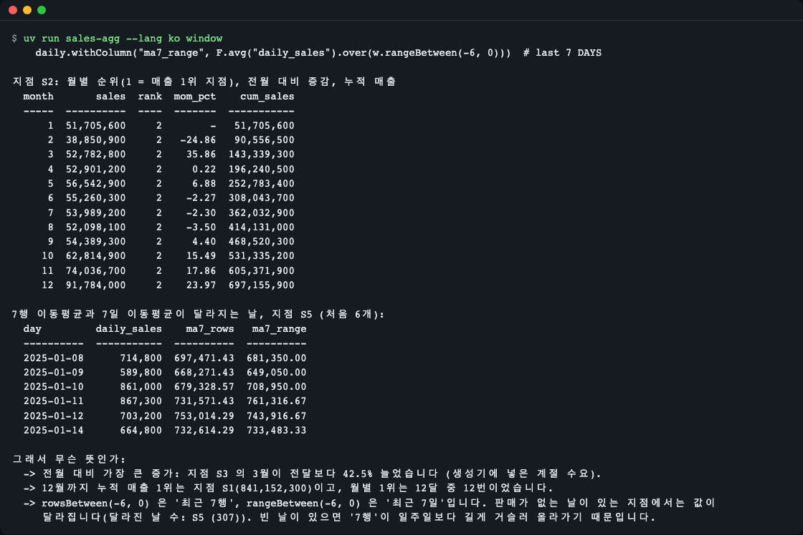
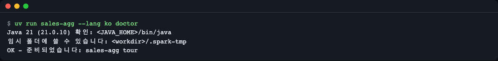
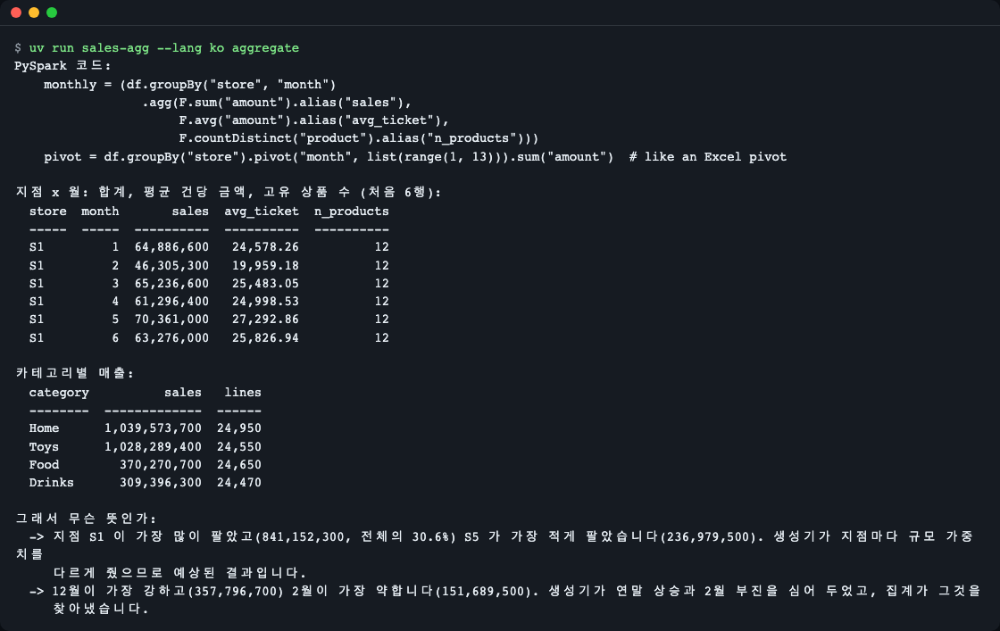
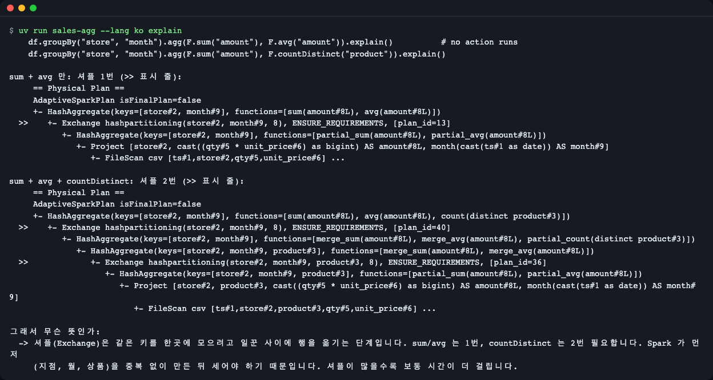
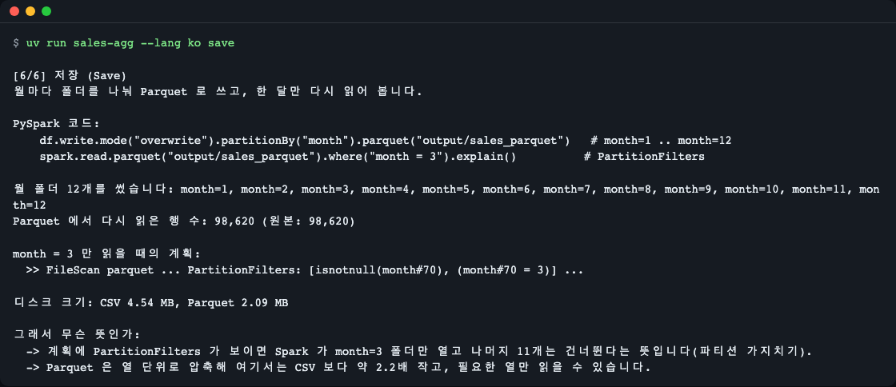
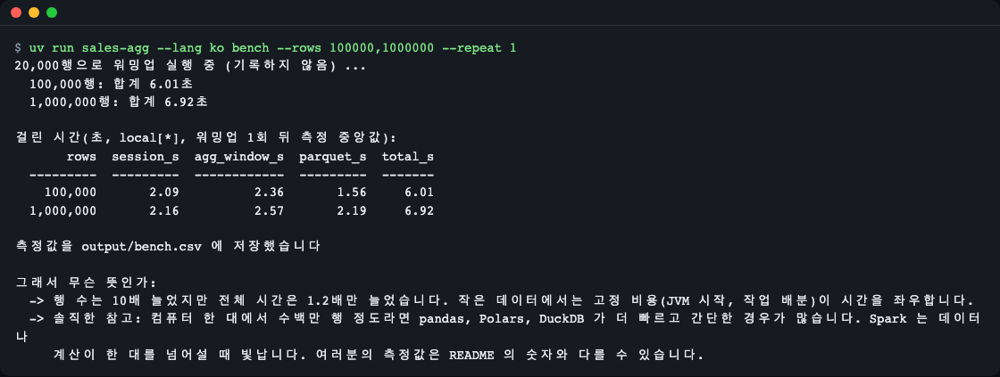
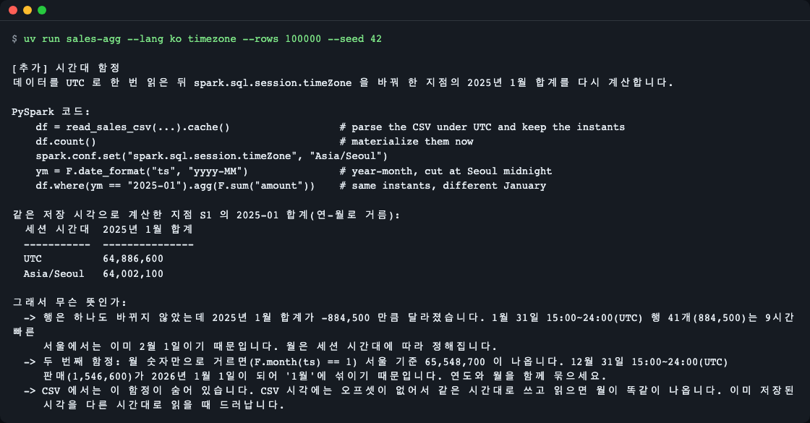
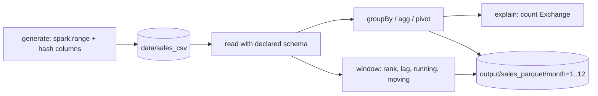

# 가짜 판매 데이터로 배우는 PySpark 집계: 합계·순위·누적값·Parquet

[English](README.md) | **한국어**

명령 하나로 PySpark 가 내 노트북에서 가짜 판매 기록 10만 행을 읽습니다. 지점·월·카테고리별 합계, 평균, 순위, 전월 대비 변화, 누적값을 계산하고 파티션된 Parquet 로 저장하며, 각 숫자의 뜻과 Spark 가 그 숫자를 어떻게 구했는지 설명해 줍니다. PySpark 시리즈 5편 중 1편이고, 각 편은 따로 실행됩니다.


<sub>Window 단계: 한 지점의 순위·전월 대비·누적 합계, 그리고 이동평균 함정. 모든 숫자는 실제 로컬 Spark 세션이 계산합니다.</sub>

## 한 줄 요약

끝까지 따라 하면 큰 CSV 를 PySpark DataFrame 으로 읽고, 기간·상품·지점별 합계·평균·순위·누적값을 계산해 Parquet 로 저장하고, 실행 계획을 읽을 수 있게 됩니다.

**이런 분께:** 엑셀·SQL·pandas 로 매출을 합산해 봤고 같은 생각을 Spark 로 해 보고 싶은 분, 처음 PySpark 를 설치하다 `JAVA_GATEWAY_EXITED` 를 만난 분.

## 왜 알아야 하나요?

영수증이 든 신발 상자를 가진 가게 주인을 떠올려 보세요. 혼자 더하면 쉽습니다. 창고 가득 상자가 있으면 도우미를 부르고, 각자 상자 하나씩 더한 뒤 소계를 합칩니다. Spark 는 CPU 코어로 이렇게 합니다. 문제는 같은 지점·같은 달의 영수증이 여러 상자에 흩어져 있으면 도우미들이 만나야 한다는 점입니다. 이 만남이 셔플(shuffle)이고 시간의 대부분이 여기서 쓰입니다. 이 데모는 몇 초 만에 만든 작은 데이터로 합계와 만남, 그 비용을 눈으로 보여 줍니다.

## 30초 만에 실행하기

Python 3.11 이상, [uv](https://docs.astral.sh/uv/), Java 17 이상, git 이 필요합니다.

```bash
# uv:     curl -LsSf https://astral.sh/uv/install.sh | sh
# Java:   macOS: brew install openjdk@21   |   Debian/Ubuntu: sudo apt-get install -y openjdk-21-jre-headless
git clone https://github.com/LeeGyeongPil/ai-lab-pyspark-sales-aggregation.git
cd ai-lab-pyspark-sales-aggregation
uv run sales-agg doctor      # Java 와 임시 폴더 점검
uv run sales-agg tour        # 여섯 단계 전부, 설치 후 약 10초
```

처음 `uv run` 은 PySpark(설치 후 약 480 MB)를 내려받아 오래 걸립니다. 목(mock) 모드는 없습니다. 데이터는 로컬에서 만든 가짜지만 Spark 는 실제로 돕니다. 아무것도 내려받거나 외부로 보내지 않고 API 키도 필요 없습니다.


<sub>`doctor` 는 Spark 를 띄우기 전에 Java 와 임시 폴더를 점검합니다. 경로는 줄여서 표시했습니다.</sub>

화면 언어: `--lang en|ko`, `SALES_AGG_LANG=ko`, 시스템 로케일(`LANG`) 순서입니다. 순서는 `--lang`, `SALES_AGG_LANG`, `LC_ALL`/`LC_MESSAGES`/`LANG` 이고 한국어가 아니면 영어입니다.

## 단계별로 따라 하기

아래 명령은 각각 `tour` 의 한 단계입니다. 천천히 읽으려면 하나씩 실행하세요. 1단계(`generate`)가 `data/sales_csv` 를 만들고 2~6단계가 읽습니다. 뒤 단계에 저장된 데이터와 다른 `--rows` 나 `--seed` 를 주면 한 줄 안내(예: "저장된 데이터는 1000행(시드 42)인데 이번 명령은 100000행(시드 42)을 요청해서 데이터를 새로 만듭니다. 기존 데이터를 그대로 쓰려면 --rows 1000 --seed 42 를 붙이세요.")가 나오고 데이터가 새로 만들어집니다. 데이터를 유지하려면 모든 단계에 같은 `--rows`·`--seed` 를 쓰세요.

### 1단계. 생성: `uv run sales-agg generate`

Spark 가 `--rows` 개(기본 100,000, 시드 42)의 가짜 판매를 만들어 CSV 로 저장합니다. 처음 실행하면 이런 줄이 보입니다.

```text
요청한 100,000행(시드 42) 중 월요일 휴무인 지점 S5 의 행을 빼고 98,620행이 남았습니다 -> <workdir>/data/sales_csv
```

같은 `--rows`·`--seed` 의 데이터가 이미 있으면(예: `tour` 를 먼저 돌린 뒤) 새로 만들지 않고 대신 이 줄이 나옵니다.

```text
같은 조건(100,000행, 시드 42)의 기존 데이터를 다시 씁니다: 98,620행, <workdir>/data/sales_csv
```

`<workdir>` 는 현재 폴더(또는 `--workdir` 로 준 폴더)입니다. 1,380행 차이는 일부러 만든 것으로, 4단계의 이동평균 함정을 보이게 합니다. 열 설명은 [docs/data-schema.md](docs/data-schema.md) 에 있습니다.

### 2단계. 탐색: `uv run sales-agg explore`

Spark 가 스키마를 직접 지정해 CSV 를 읽고 `amount = qty * unit_price` 열을 만듭니다. 출력 예(시간은 실행마다 다름):

```text
계획 세우기(filter + select + 새 컬럼)에 0.0235초가 걸렸습니다. 그 뒤 count() 액션이 0.87초 걸려 60,842행을 셌습니다.
```

이것이 지연 실행(lazy evaluation)입니다. `filter` 같은 변환은 계획만 세우고 `count()` 같은 액션이 있어야 실제로 일합니다.

### 3단계. 집계: `uv run sales-agg aggregate`

`groupBy("store", "month").agg(sum, avg, countDistinct)` 는 지점·월마다 요약 한 줄을 만듭니다. 엑셀 피벗 테이블과 비슷합니다. `pivot("month", ...)` 는 월을 열로 돌립니다.


<sub>지점×월 합계, 카테고리 합계. "그래서 무슨 뜻인가" 아래 문장은 실제 숫자로 만들어집니다.</sub>

숫자를 보고 도구가 말해 줍니다: 지점 S1 이 가장 많이 팔았고(841,152,300, 30.6%), S5 가 가장 적습니다. 12월이 가장 강하고 2월이 가장 약합니다. 이 패턴은 실제 가게가 아니라 생성기가 심은 것입니다.

### 4단계. 윈도우: `uv run sales-agg window`

윈도우 함수는 행을 합치지 않고 이웃 행을 봅니다. 지점 간 `rank()`, 지난달 값 `lag()`, `rowsBetween(unboundedPreceding, 0)` 로 누적 합계를 구합니다.


<sub>지점 S2: 매달 2위, 2월 24.86% 하락, 12월까지 누적 697,155,900.</sub>

바로 전달에 판매가 없는 지점은 지난달 대비가 이전 달과 비교되지 않고 `-`(null)로 표시됩니다. `--rows 10` 같은 작은 데이터에서만 보이며, 기본 100,000행은 모든 달이 있습니다.

아래쪽 함정: 지점 S5 는 월요일에 쉽니다. `rowsBetween(-6, 0)` 은 최근 7개 행의 평균이라 쉬는 날을 건너뛰면 일주일보다 더 거슬러 올라갑니다. `rangeBetween(-6, 0)` 은 최근 7일 평균입니다. 실제 실행에서 S5 는 307일이 다릅니다(예: 2025-01-08 은 697,471.43 대 681,350.00).

### 5단계. 계획 보기: `uv run sales-agg explain`

`explain()` 은 실행하지 않고 물리 계획을 출력합니다. `Exchange hashpartitioning` 한 줄이 셔플 한 번입니다.


<sub>sum + avg + countDistinct 의 계획. `>>` 표시가 셔플 2번이고, countDistinct 가 없으면 1번입니다.</sub>

`countDistinct` 는 먼저 (지점, 월, 상품)을 유일하게 만든 뒤 세기 때문에 셔플이 하나 더 필요합니다.

### 6단계. 저장: `uv run sales-agg save`

월마다 폴더 하나씩 Parquet 로 쓰고, `month = 3` 만 다시 읽습니다.


<sub>`month=1` ~ `month=12` 폴더 12개. 다시 읽은 98,620행이 원본과 같습니다. `PartitionFilters` 는 나머지 11개 폴더를 건너뛴다는 뜻입니다.</sub>

Parquet 는 CSV(4.54 MB)보다 약 2.2배 작고(2.09 MB), Spark 가 필요한 열만 읽을 수 있습니다. 데이터가 아주 적으면(예: `--rows 5000`) 월 폴더 12개의 오버헤드가 압축 이득보다 커서 Parquet 가 CSV 보다 클 수 있습니다.

### 선택: 얼마나 걸릴까? `uv run sales-agg bench`

```bash
uv run sales-agg bench --rows 100000,1000000 --repeat 1
```


<sub>워밍업 1회는 기록하지 않고, 크기마다 새 JVM 을 띄웁니다. 시간은 컴퓨터마다 다릅니다.</sub>

행은 10배인데 총 시간은 실행마다 약 1.1~1.3배만 늘었습니다(스크린샷 참고). JVM 시작과 작업 배정 같은 고정 비용이 작은 데이터에서는 지배적이기 때문입니다. 컴퓨터 한 대의 수백만 행이라면 pandas·Polars·DuckDB 가 더 빠르고 간단한 경우가 많습니다. Spark 는 데이터나 계산이 한 대를 넘을 때 값을 합니다.

측정 환경: Apple Silicon Mac(arm64, macOS 27.0.1), OpenJDK 21.0.10, PySpark 4.3.0, `local[*]`. 시간은 컴퓨터마다 다릅니다.

### 추가: 시간대 함정 `uv run sales-agg timezone`

```bash
uv run sales-agg timezone --rows 100000 --seed 42
```


<sub>저장된 시각이 같아도 세션 시간대를 Asia/Seoul 로 바꾸면 2025년 1월 합계가 줄어듭니다.</sub>

이 명령은 CSV 를 UTC 로 한 번 읽어 파싱된 시각(시간 위의 한 점)을 캐시합니다. 그다음 메모리에서 `spark.sql.session.timeZone` 을 `Asia/Seoul` 로 바꾸고, 연-월로 걸러(`F.date_format("ts", "yyyy-MM") == "2025-01"`) 지점 S1 의 2025년 1월 합계를 다시 계산합니다.

```text
  세션 시간대  2025년 1월 합계
  -----------  ---------------
  UTC          64,886,600
  Asia/Seoul   64,002,100
```

- **첫 번째 함정:** 행은 하나도 바뀌지 않았는데 2025년 1월 합계가 884,500 줄었습니다. 1월 31일 15:00~24:00(UTC)에 팔린 41행의 합이 884,500 입니다. 서울은 9시간 빨라서 이 행들은 서울 기준으로 이미 2월 1일입니다.
- **두 번째 함정:** 월 숫자만으로 거르면(`F.month(ts) == 1`) 서울 기준 65,548,700 으로 오히려 UTC 보다 커집니다. 12월 31일 15:00~24:00(UTC) 판매(1,546,600)가 서울에서는 2026년 1월 1일이 되어 '1월'에 섞이기 때문입니다. 연도와 월을 함께 묶으세요.
- 검산: 64,886,600 − 884,500 = 64,002,100, 64,002,100 + 1,546,600 = 65,548,700.

## 어떻게 동작하나요?



- `generate` 는 모든 열을 JVM 안의 해시 식으로 만들고, 열마다 해시를 따로 써서 지점과 날짜가 서로 독립입니다.
- CSV 는 스키마를 직접 지정해 읽어, 타입을 추측하려고 파일을 훑지 않습니다.
- `groupBy` 와 `Window` 는 집계의 두 방식입니다. 앞은 행을 합치고 뒤는 행을 유지합니다.
- `explain` 은 그 둘이 치르는 셔플을 보여 줍니다.
- `save` 는 월마다 폴더를 써서 나중 조회가 나머지를 건너뛰게 합니다.

같은 계산을 SQL 로 (DataFrame 결과와 같음):

```python
df.createOrReplaceTempView("sales")
spark.sql("SELECT store, month, SUM(amount) AS sales, AVG(amount) AS avg_ticket FROM sales GROUP BY store, month")
```

| 아는 것 | PySpark |
|---|---|
| 엑셀 피벗 테이블 | `groupBy(...).pivot(...).sum(...)` |
| SQL `GROUP BY` | `groupBy(...).agg(...)` |
| SQL `RANK() OVER (...)` | `F.rank().over(Window...)` |
| 엑셀 누적 합계 | `F.sum(...).over(w.rowsBetween(Window.unboundedPreceding, 0))` |
| pandas `df[df.qty >= 3]` | `df.filter(F.col("qty") >= 3)` (지연 실행) |

## 코드 둘러보기

| 파일 | 하는 일 |
|---|---|
| [`src/sales_agg/data.py`](src/sales_agg/data.py) | 결정적 데이터 생성기(열마다 해시) |
| [`src/sales_agg/steps/aggregate.py`](src/sales_agg/steps/aggregate.py) | groupBy, agg, pivot |
| [`src/sales_agg/steps/window.py`](src/sales_agg/steps/window.py) | rank, lag, 누적 합계, rows 대 range |
| [`src/sales_agg/steps/explain.py`](src/sales_agg/steps/explain.py) | 계획에서 `Exchange` 줄을 셈 |
| [`src/sales_agg/session.py`](src/sales_agg/session.py) | 세션 설정: UTC, 셔플 파티션 8, 로컬 임시 폴더 |
| [`src/sales_agg/steps/timezone.py`](src/sales_agg/steps/timezone.py) | 캐시한 시각을 다른 세션 시간대로 다시 읽어 연-월 합계를 비교 |
| [`tests/`](tests) | 실제 Spark 세션으로 도는 테스트 35개, 순수 Python 기준값과 비교 |

읽어 볼 만한 세 곳:

1. **윈도우 사양** ([`window.py`](src/sales_agg/steps/window.py)): `Window.partitionBy("store").orderBy("day_no")` 를 `rowsBetween` 과 `rangeBetween` 에 같이 씁니다. 프레임만 바뀌어도 답이 달라집니다.
2. **세션 설정** ([`session.py`](src/sales_agg/session.py)): `spark.sql.session.timeZone=UTC` 로 월 경계가 내 컴퓨터에 좌우되지 않게 하고, `shuffle.partitions` 는 기본 200 대신 8 로 둡니다. 작은 데이터에 200개 작은 작업은 오히려 느립니다.
3. **계획 테스트** ([`tests/test_explain.py`](tests/test_explain.py)): sum/avg 는 `Exchange` 1개, `countDistinct` 가 있으면 2개임을 검사해 README 설명이 계속 맞게 합니다.

## 용어 사전

| 용어 | 뜻 |
|---|---|
| DataFrame | 이름과 타입이 있는 열로 된 표. Spark 가 병렬로 계산합니다 |
| 변환 / 액션 | 변환(`filter`, `select`)은 계획만 세우고, 액션(`count`, `show`, `write`)이 실행합니다 |
| 지연 실행 | 전체 계획을 최적화하려고 액션이 있을 때까지 일을 미루는 것 |
| 파티션 | 작업 하나가 처리하는 데이터 조각 |
| 셔플 / Exchange | 같은 키가 한곳에 모이도록 작업 사이에 행을 옮기는 것. 비용이 큰 부분 |
| 윈도우 함수 | 모든 행을 유지한 채 이웃 행을 보고 계산하는 함수 |
| Parquet | 압축된 열 기반 파일 형식. `month=3` 같은 폴더가 파티션입니다 |
| 파티션 가지치기 | 조건에 맞을 수 없는 폴더를 건너뛰는 것(계획의 `PartitionFilters`) |
| `local[*]` | 한 프로세스 안에서 모든 CPU 코어로 Spark 를 돌리는 모드 |

## 직접 바꿔 보기

1. **다른 시드** — `uv run sales-agg aggregate --seed 7` 실행 → 합계는 달라지고 모양은 같음(S1 최대, 12월 최강) → "그래서 무슨 뜻인가" 줄을 비교합니다.
2. **셔플 파티션 줄이기** — [`session.py`](src/sales_agg/session.py) 의 `shuffle.partitions` 를 200 으로 변경 → 결과는 같고 작은 데이터에서 더 느림 → `bench --rows 100000 --repeat 1` 의 `agg_window_s` 를 비교합니다.
3. **시간대 함정** — `uv run sales-agg timezone --rows 100000 --seed 42` 실행 → S1 의 2025년 1월 합계가 64,886,600(UTC)에서 64,002,100(Asia/Seoul)으로 줄어듦. 서울은 9시간 빨라 1월 31일 저녁(UTC) 판매 41건(884,500)이 2월로 집계되기 때문이고, 월 숫자만으로 거르면 65,548,700 이 된다는 "두 번째 함정" 줄도 함께 나옴 → `tests/test_session.py` 가 메모리에서 같은 전환을 하고, 서울 합계가 UTC 합계에서 1월 31일 저녁 판매를 뺀 값과 같은지 검사합니다. `session.py` 를 고쳐 시도하지 마세요. CSV 시각에는 오프셋이 없어 쓰기·읽기를 같은 시간대로 하면 같은 달이 나와 함정이 가려집니다(그 테스트도 UTC 를 검사합니다).

## 자주 겪는 문제

| 증상 | 원인 | 해결 |
|---|---|---|
| `JAVA_GATEWAY_EXITED` 또는 "Java gateway process exited" | Java 없음·너무 낮은 버전, 또는 JVM 이 임시 폴더에 쓰지 못함 | `uv run sales-agg doctor` 를 실행하면 원인과 설치 방법을 알려 줍니다(종료 코드 2) |
| `Picked up JAVA_TOOL_OPTIONS` 와 `NativeCodeLoader` 경고 | 도구가 임시 폴더를 지정하고, Spark 는 Hadoop 네이티브 라이브러리가 없다고 경고 | 무해합니다. `2>/dev/null` 로 숨길 수 있습니다 |
| 데이터가 다시 만들어지고 합계가 바뀜 | 뒤 단계에 저장된 데이터와 다른 `--rows`/`--seed` 를 줌 | 한 줄 안내를 읽고, 안내가 알려 주는 `--rows`/`--seed` 를 주면 기존 데이터를 씁니다 |
| `--rows` 보다 행이 적음 | 지점 S5 가 월요일에 일부러 쉼 | 정상입니다. 1단계 참고 |
| 첫 실행이 느림 | PySpark 내려받기(~480 MB)와 JVM 시작 | 한 번만 기다리면 됩니다. 이후엔 약 2~3초 만에 시작 |
| 다른 폴더에서 실행하면 그곳에 파일이 생김 | 출력은 현재 폴더에 씀 | `SALES_AGG_WORKDIR` 를 지정하거나 `--workdir` 를 씁니다 |

테스트는 `uv run pytest -q` (35개, 1분 남짓, 실제 Spark).

## 시리즈

5편 중 1편(집계). 2~5편은 회귀, 수요 예측, 이탈 분류, 이상 탐지를 다루며 [docs/data-schema.md](docs/data-schema.md) 의 데이터 규칙을 공유하고 따로 공개됩니다.

## 더 알아보기

- [PySpark 설치 (Python·Java·의존성 요구사항)](https://spark.apache.org/docs/latest/api/python/getting_started/install.html) — 2026-11-14 확인
- [Spark 4.3.0 릴리스 노트](https://spark.apache.org/releases/spark-release-4-3-0.html) — 2026-11-14 확인
- [Spark 버전 정책](https://spark.apache.org/versioning-policy.html) — 2026-11-14 확인
- [Spark SQL 의 Parquet 파일](https://spark.apache.org/docs/latest/sql-data-sources-parquet.html)
- [성능 튜닝 (셔플 파티션)](https://spark.apache.org/docs/latest/sql-performance-tuning.html)

## 라이선스

MIT — [LICENSE](LICENSE). 데이터는 로컬에서 생성한 것이며 실제 기록이 없습니다.
