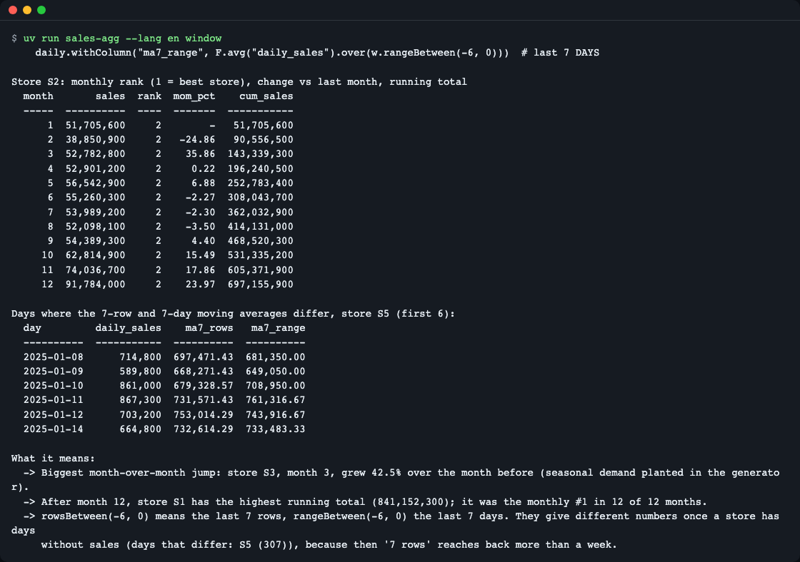
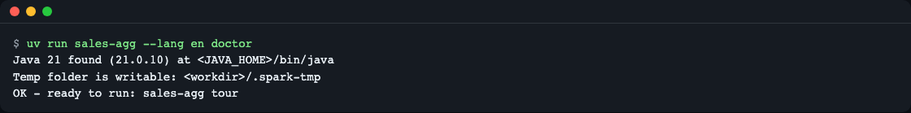
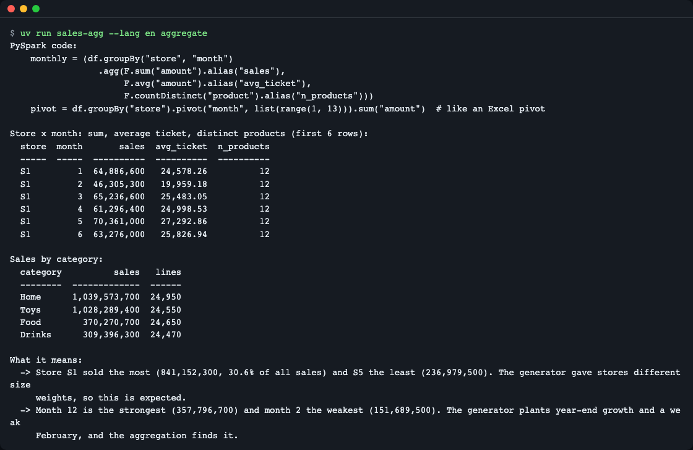
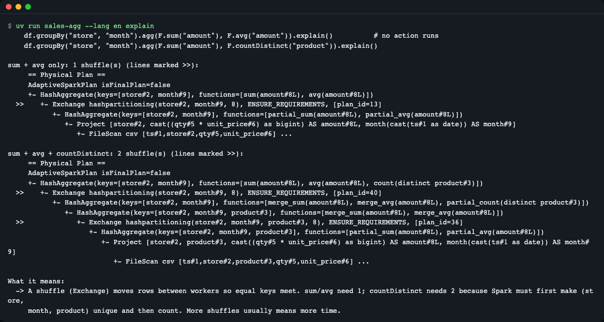
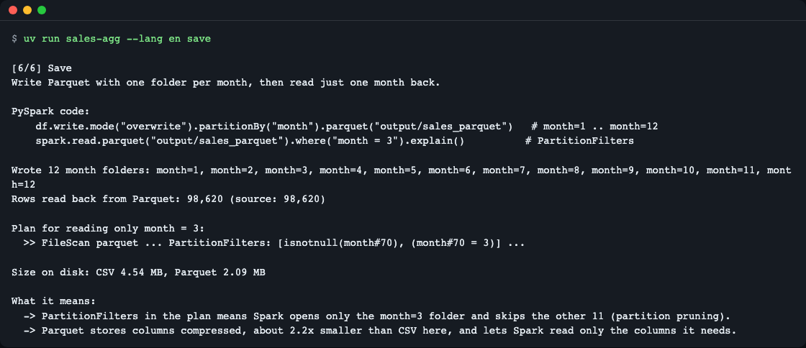
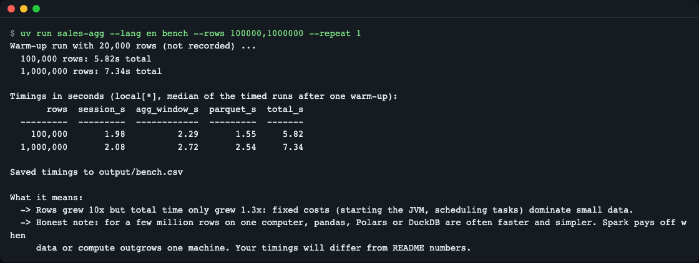
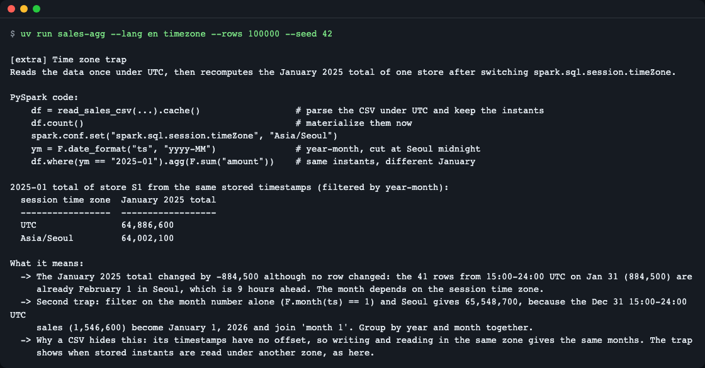
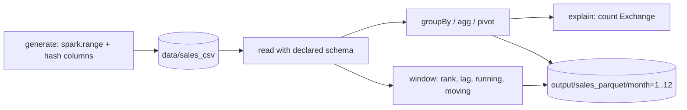

# Learn PySpark aggregation with fake sales data: totals, ranks, running values, Parquet

**English** | [한국어](README.ko.md)

Run one command and PySpark reads 100,000 synthetic sales rows on your laptop. It computes totals, averages, ranks, month-over-month change and running values by store, month and category, saves partitioned Parquet, and explains each number and how Spark got it. This is part 1 of a 5-part PySpark series; every part runs on its own.


<sub>The Window step: rank, month-over-month change and running total for one store, then a moving-average trap. Every number is computed by a real local Spark session.</sub>

## One-line summary

Follow the walkthrough to the end and you can read a large CSV into a PySpark DataFrame, compute sums, averages, ranks and cumulative values by period, product and store, save the result as Parquet, and read an execution plan.

**For you if:** you have summed sales in Excel, SQL or pandas and want to see the same thinking in Spark; or you hit `JAVA_GATEWAY_EXITED` on your first PySpark install.

## Why does this matter?

Think of a shop owner with a shoebox of receipts. Adding them up alone is easy. With a warehouse of boxes you hire helpers: each adds one box, then they combine the subtotals. Spark does this with your CPU cores. The catch is that the helpers must meet when two boxes hold the same store and month. That meeting is called a shuffle, and it is where most of the time goes. This demo lets you see the sums, the meetings and the cost with small data you can generate in seconds.

## Run it in 30 seconds

You need Python 3.11+, [uv](https://docs.astral.sh/uv/), Java 17+ and git.

```bash
# uv:     curl -LsSf https://astral.sh/uv/install.sh | sh
# Java:   macOS: brew install openjdk@21   |   Debian/Ubuntu: sudo apt-get install -y openjdk-21-jre-headless
git clone https://github.com/LeeGyeongPil/ai-lab-pyspark-sales-aggregation.git
cd ai-lab-pyspark-sales-aggregation
uv run sales-agg doctor      # checks Java and the temp folder
uv run sales-agg tour        # all six steps, about 10 seconds after the first install
```

The first `uv run` downloads PySpark (about 480 MB installed), so it takes a while. There is no mock mode: the data is fake and generated locally, but Spark really runs. Nothing is downloaded or sent anywhere, and no API key is needed.


<sub>`doctor` checks Java and the temp folder before Spark starts. Paths are shortened here.</sub>

Screen language: `--lang en|ko`, or `SALES_AGG_LANG=ko`, or your system locale (`LANG`). The order is `--lang`, then `SALES_AGG_LANG`, then `LC_ALL`/`LC_MESSAGES`/`LANG`; anything not Korean falls back to English.

## Follow along step by step

Each command below is one step of `tour`. Run them one at a time to read slowly. Step 1 (`generate`) writes `data/sales_csv`; steps 2 to 6 read it. If you pass a different `--rows` or `--seed` to a later step than the saved data has, the tool prints a one-line notice ("Saved data has 1000 rows (seed 42) but this command asked for 100000 rows (seed 42), so the data is regenerated. Pass --rows 1000 --seed 42 to keep and reuse the existing data.") and regenerates the data. Use the same `--rows` and `--seed` on every step to keep your data.

### Step 1. Generate: `uv run sales-agg generate`

Spark creates `--rows` fake sales (default 100,000, seed 42) and saves CSV. On the first run you will see:

```text
Generated 100,000 requested rows (seed 42); 98,620 remain after closing store S5 on Mondays -> <workdir>/data/sales_csv
```

If data with the same `--rows` and `--seed` already exists (for example after `tour`), nothing is regenerated and you see this line instead:

```text
Reusing existing data for 100,000 rows (seed 42): 98,620 rows in <workdir>/data/sales_csv
```

`<workdir>` is your current folder (or `--workdir`). The 1,380-row gap is on purpose: it makes the moving-average trap in step 4 visible. The data columns are in [docs/data-schema.md](docs/data-schema.md).

### Step 2. Explore: `uv run sales-agg explore`

Spark reads the CSV with a declared schema and builds an `amount = qty * unit_price` column. Typical output (timings vary):

```text
Building the plan (filter + select + new column) took 0.0216s. The count() action then took 0.91s and counted 60,842 rows.
```

It then shows the five largest order lines with `qty >= 3`, one per store and product, so you can see the computed `amount` column.

This is lazy evaluation: transformations such as `filter` only build a plan, and nothing runs until an action such as `count()`.

### Step 3. Aggregate: `uv run sales-agg aggregate`

`groupBy("store", "month").agg(sum, avg, countDistinct)` gives one summary row per store and month, like an Excel pivot table. `pivot("month", ...)` turns months into columns.


<sub>Store x month totals and category totals. The text under "What it means" is generated from the real numbers.</sub>

The tool then tells you, from the numbers: store S1 sold the most (841,152,300, 30.6%), S5 the least; month 12 was strongest, month 2 weakest. These patterns come from the generator, not from real shops.

### Step 4. Window: `uv run sales-agg window`

Window functions look at neighbouring rows without collapsing them: `rank()` across stores, `lag()` for last month, a running total with `rowsBetween(unboundedPreceding, 0)`.


<sub>Store S2: rank 2 every month, a 24.86% drop in February, running total 697,155,900 by December.</sub>

If a store has no sales in the month before, the change vs last month is `-` (null) instead of being compared with an earlier month. This only shows on tiny data such as `--rows 10`; the default 100,000 rows have every month.

The trap at the bottom: store S5 is closed on Mondays. `rowsBetween(-6, 0)` averages the last 7 rows, so across a closed day it reaches back more than a week. `rangeBetween(-6, 0)` averages the last 7 days. In the real run they differ on 307 days of S5 (for example 2025-01-08: 697,471.43 versus 681,350.00).

### Step 5. Explain: `uv run sales-agg explain`

`explain()` prints the physical plan without running it. Each `Exchange hashpartitioning` line is one shuffle.


<sub>Plan for sum + avg + countDistinct. The `>>` marks show 2 shuffles; without countDistinct there is only 1.</sub>

`countDistinct` needs an extra shuffle because Spark first makes (store, month, product) unique, then counts.

### Step 6. Save: `uv run sales-agg save`

Writes Parquet with one folder per month, then reads only `month = 3`.


<sub>12 folders `month=1` to `month=12`. 98,620 rows read back equals the source. `PartitionFilters` means Spark skipped the other 11 folders.</sub>

Parquet here is about 2.2x smaller than the CSV (2.09 MB versus 4.54 MB) and Spark can read only the columns it needs. With very small data (for example `--rows 5000`) Parquet can be larger than the CSV, because the overhead of 12 month folders outweighs the compression gain.

### Optional: how long does it take? `uv run sales-agg bench`

```bash
uv run sales-agg bench --rows 100000,1000000 --repeat 1
```


<sub>One warm-up run is not recorded. A fresh JVM is started per size. Your timings will differ.</sub>

Rows grew 10x but total time grew only about 1.1-1.3x depending on the run (see the screenshot): starting the JVM and scheduling tasks dominate small data. For a few million rows on one computer, pandas, Polars or DuckDB are often faster and simpler. Spark pays off when data or compute outgrows one machine.

Measured on an Apple Silicon Mac (arm64, macOS 27.0.1), OpenJDK 21.0.10, PySpark 4.3.0, `local[*]`. Your numbers will differ.

### Extra: the time-zone trap, `uv run sales-agg timezone`

```bash
uv run sales-agg timezone --rows 100000 --seed 42
```


<sub>The same stored timestamps give a smaller January 2025 total when the session time zone changes to Asia/Seoul.</sub>

The command reads the CSV once under UTC and caches the parsed instants (points in time). It then switches `spark.sql.session.timeZone` to `Asia/Seoul` in memory and recomputes the January 2025 total of store S1, filtering by year and month (`F.date_format("ts", "yyyy-MM") == "2025-01"`):

```text
  session time zone  January 2025 total
  -----------------  ------------------
  UTC                64,886,600
  Asia/Seoul         64,002,100
```

- **First trap:** no row changed, yet January 2025 shrank by 884,500. The 41 rows sold between 15:00 and 24:00 UTC on January 31 add up to 884,500. Seoul is 9 hours ahead, so for Seoul they are already February 1.
- **Second trap:** filter on the month number alone (`F.month(ts) == 1`) and Seoul gives 65,548,700, more than UTC. The sales from 15:00-24:00 UTC on December 31 (1,546,600) become January 1, 2026 in Seoul and join "month 1". Group by year and month together.
- Check: 64,886,600 − 884,500 = 64,002,100, and 64,002,100 + 1,546,600 = 65,548,700.

## How it works



- `generate` builds every column as a hash expression inside the JVM, with its own hash per column so store and day stay independent.
- The CSV is read with a declared schema, so Spark does not scan the file just to guess types.
- `groupBy` and `Window` are the two ways to aggregate: the first collapses rows, the second keeps them.
- `explain` shows the shuffles that those two cost.
- `save` writes one folder per month so a later query can skip the rest.

The same idea in SQL (the DataFrame result is identical):

```python
df.createOrReplaceTempView("sales")
spark.sql("SELECT store, month, SUM(amount) AS sales, AVG(amount) AS avg_ticket FROM sales GROUP BY store, month")
```

| You know | PySpark |
|---|---|
| Excel pivot table | `groupBy(...).pivot(...).sum(...)` |
| SQL `GROUP BY` | `groupBy(...).agg(...)` |
| SQL `RANK() OVER (...)` | `F.rank().over(Window...)` |
| Excel running total | `F.sum(...).over(w.rowsBetween(Window.unboundedPreceding, 0))` |
| pandas `df[df.qty >= 3]` | `df.filter(F.col("qty") >= 3)` (lazy) |

## Code tour

| File | What it does |
|---|---|
| [`src/sales_agg/data.py`](src/sales_agg/data.py) | Deterministic data generator (hash per column) |
| [`src/sales_agg/steps/aggregate.py`](src/sales_agg/steps/aggregate.py) | groupBy, agg, pivot |
| [`src/sales_agg/steps/window.py`](src/sales_agg/steps/window.py) | rank, lag, running total, rows vs range |
| [`src/sales_agg/steps/explain.py`](src/sales_agg/steps/explain.py) | Counts `Exchange` lines in the plan |
| [`src/sales_agg/session.py`](src/sales_agg/session.py) | Session settings: UTC, 8 shuffle partitions, local temp folder |
| [`src/sales_agg/steps/timezone.py`](src/sales_agg/steps/timezone.py) | Re-reads cached instants under another session time zone and compares year-month totals |
| [`tests/`](tests) | 44 tests against a real Spark session, compared with a pure-Python reference |

Three places worth reading:

1. **Window specs** ([`window.py`](src/sales_agg/steps/window.py)): `Window.partitionBy("store").orderBy("day_no")` is reused with `rowsBetween` and `rangeBetween`; only the frame changes the answer.
2. **Session settings** ([`session.py`](src/sales_agg/session.py)): `spark.sql.session.timeZone=UTC` so month boundaries do not depend on your computer; `shuffle.partitions=8` instead of the default 200, because 200 tiny tasks are slower than the data deserves.
3. **Plan test** ([`tests/test_explain.py`](tests/test_explain.py)): asserts 1 `Exchange` for sum/avg and 2 with `countDistinct`, so the explanation in this README stays true.

## Glossary

| Term | Meaning |
|---|---|
| DataFrame | A table with named, typed columns that Spark computes in parallel |
| Transformation / action | A transformation (`filter`, `select`) only builds a plan; an action (`count`, `show`, `write`) runs it |
| Lazy evaluation | Spark delays work until an action so it can optimise the whole plan |
| Partition | One slice of the data processed by one task |
| Shuffle / Exchange | Moving rows between tasks so equal keys end up together; the costly part |
| Window function | A calculation over neighbouring rows that keeps every row |
| Parquet | A compressed column-based file format; folders such as `month=3` are partitions |
| Partition pruning | Skipping folders that cannot match the filter (`PartitionFilters` in the plan) |
| `local[*]` | Run Spark inside one process using all CPU cores |

## Try changing things

1. **A different seed** — run `uv run sales-agg aggregate --seed 7` → different totals, same shape (S1 largest, December strongest) → compare the "What it means" lines.
2. **Fewer shuffle partitions** — in [`session.py`](src/sales_agg/session.py) change `shuffle.partitions` to 200 → same results, slower on small data → run `bench --rows 100000 --repeat 1` and compare `agg_window_s`.
3. **The time-zone trap** — run `uv run sales-agg timezone --rows 100000 --seed 42` → the January 2025 total of S1 drops from 64,886,600 (UTC) to 64,002,100 (Asia/Seoul), because Seoul is 9 hours ahead and the 41 sales from the evening of January 31 (UTC, 884,500) count as February; the "Second trap" line shows 65,548,700 if you filter on the month number alone → `tests/test_session.py` does the same switch in memory and checks that the Seoul total equals the UTC total minus the January 31 evening sales. Do not edit `session.py` to try it: a CSV timestamp has no offset, so writing and reading in the same zone gives the same months and hides the trap (and that test asserts UTC).

## Troubleshooting

| Symptom | Cause | Fix |
|---|---|---|
| `JAVA_GATEWAY_EXITED` or "Java gateway process exited" | Java missing, too old, or the JVM cannot write its temp folder | Run `uv run sales-agg doctor`; it prints the cause and install steps (exit code 2) |
| `Picked up JAVA_TOOL_OPTIONS` and a `NativeCodeLoader` warning | The tool sets the temp folder; Spark warns it has no Hadoop native library | Harmless. Hide with `2>/dev/null` |
| Data was regenerated and totals changed | A later step got a different `--rows`/`--seed` than the saved data | Read the one-line notice; pass the `--rows`/`--seed` it prints to reuse the data |
| Fewer rows than `--rows` | Store S5 is closed on Mondays on purpose | Expected; see step 1 |
| First run is slow | PySpark download (~480 MB) and JVM start | Wait once; later runs start in about 2 to 3 seconds |
| Run from another folder writes files there | Output goes to the current folder | Set `SALES_AGG_WORKDIR` or pass `--workdir` |

Run the tests with `uv run pytest -q` (44 tests, about a minute, real Spark).

## Series

Part 1 of 5 (aggregation). Parts 2 to 5 cover regression, demand forecasting, churn classification and anomaly detection. They share the data conventions in [docs/data-schema.md](docs/data-schema.md) and are published separately.

## Learn more

- [PySpark installation (Python, Java and dependency requirements)](https://spark.apache.org/docs/latest/api/python/getting_started/install.html) — checked 2026-11-14
- [Spark 4.3.0 release notes](https://spark.apache.org/releases/spark-release-4-3-0.html) — checked 2026-11-14
- [Spark versioning policy](https://spark.apache.org/versioning-policy.html) — checked 2026-11-14
- [Parquet files in Spark SQL](https://spark.apache.org/docs/latest/sql-data-sources-parquet.html)
- [Performance tuning (shuffle partitions)](https://spark.apache.org/docs/latest/sql-performance-tuning.html)

## License

MIT — [LICENSE](LICENSE). The data is generated locally and contains no real records.
